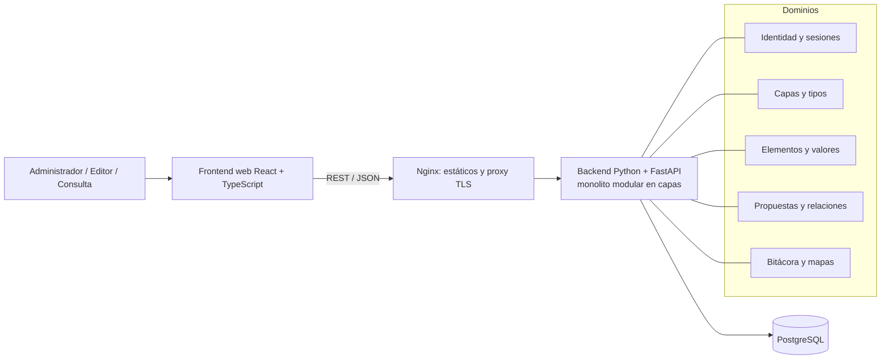

# TC5062-21
# Plataforma de Arquitectura Empresarial — Equipo 21

> **Estado de esta documentación:** preparada a partir del paquete técnico consolidado disponible (`openapi_equipo.yaml`, `main.py`, `esquema_bd.sql`, `requirements.txt`, `.env.example`, `postman_collection.json` y `arquitectura_equipo.md`). El paquete no contiene una aplicación frontend ni evidencia de un despliegue productivo. No se deben interpretar las rutas del contrato OpenAPI como rutas ya implementadas.

## 1. Descripción del proyecto

La Plataforma de Arquitectura Empresarial busca organizar información de arquitectura mediante capas, tipos de elementos configurables, elementos, tipos de relación, propuestas de vínculos, relaciones validadas y una bitácora de auditoría. El valor esperado es centralizar la consulta y administración de estos artefactos, conservar trazabilidad de cambios y permitir explorar las conexiones entre elementos.

El dominio contempla perfiles Administrador, Editor y Consulta. El contrato funcional especifica autenticación/sesiones, administración de cuentas y capas, configuración de tipos y campos, gestión de elementos, propuestas y decisiones de relaciones, mapas y bitácora. **La implementación entregada es una primera API CRUD parcial**; no equivale a la solución completa descrita en el contrato.

### Alcance real de esta entrega

- Backend API con FastAPI y conexión a PostgreSQL.
- Endpoints implementados para salud, capas, tipos de elemento, tipos de relación, cuentas, consulta de elementos, consulta de relaciones y bitácora, además de una respuesta de muestra demostrativa.
- Esquema relacional y contrato OpenAPI más amplio que la implementación.
- Colección Postman con cuatro solicitudes: health check, creación de capa, consulta de capa creada y comprobación de 404.
- No se incluye frontend React/TypeScript, Nginx, autenticación/autorización real, ni suite automatizada en `backend/tests/` en el paquete revisado.

## 2. Arquitectura

### Diagrama lógico objetivo



El diagrama representa la **arquitectura consolidada/objetivo** descrita en `arquitectura_equipo.md`, no un despliegue que se haya podido verificar en ejecución. En el paquete implementado solo se observa el backend FastAPI y el esquema PostgreSQL. No hay código frontend ni configuración Nginx en los archivos revisados.

### Responsabilidades

| Componente | Responsabilidad prevista | Estado en el paquete revisado |
|---|---|---|
| Frontend React + TypeScript | Formularios, búsqueda, propuestas y visualización | No incluido |
| Nginx | Servir estáticos, TLS y proxy `/api` | No incluido |
| FastAPI | API REST, validación y acceso a datos | Implementación parcial en `main.py` |
| PostgreSQL | Persistencia relacional y restricciones | Esquema en `esquema_bd.sql`; conexión configurada por `DATABASE_URL`; integración no acreditada con evidencia de ejecución |

## 3. Stack tecnológico

| Tecnología | Versión / rango declarado | Propósito |
|---|---|---|
| Python | 3.11+ | Lenguaje del backend (según README del paquete) |
| FastAPI | `>=0.115,<1.0` | API REST y documentación OpenAPI |
| Uvicorn | `>=0.30,<1.0` | Servidor ASGI local |
| SQLAlchemy | `>=2.0,<3.0` | Acceso y ejecución SQL |
| psycopg (binary) | `>=3.2,<4.0` | Driver PostgreSQL |
| python-dotenv | `>=1.0,<2.0` | Carga de variables desde `.env` |
| Pydantic | `>=2.8,<3.0` | Validación de modelos de entrada |
| PostgreSQL | 15+ | Base de datos relacional |
| Postman | Colección v2.1.0 | Ejecución manual de solicitudes de API |
| React + TypeScript | No declarada en el paquete | Frontend objetivo, no incluido en esta entrega |
| Nginx | No declarada en el paquete | Proxy/servidor objetivo, no incluido |

Las dependencias Python están expresadas como rangos en `requirements.txt`; no existe un archivo de bloqueo que fije versiones exactas. Por tanto, no se afirma que se haya probado con una versión puntual de cada dependencia.

## 4. Instalación y ejecución local

### Prerrequisitos

- Git.
- Python 3.11 o posterior.
- PostgreSQL 15 o posterior y `psql`.
- Terminal con permisos para crear una base de datos.

### Paso 1. Clonar el repositorio

```bash
git clone https://github.com/CLA-TC5062-SN2026/TC5062-21.git
cd TC5062-21
```

> La estructura exacta del repositorio remoto no se pudo validar desde este entorno. Los comandos siguientes corresponden al paquete técnico disponible. Si el equipo guarda estos archivos en una subcarpeta, entra a esa carpeta antes de ejecutarlos.

### Paso 2. Crear y activar un entorno virtual

```bash
python -m venv .venv
```

Windows PowerShell:

```powershell
.venv\Scripts\Activate.ps1
```

macOS/Linux:

```bash
source .venv/bin/activate
```

### Paso 3. Instalar dependencias

```bash
pip install -r requirements.txt
```

### Paso 4. Crear la base de datos y cargar el esquema

```bash
createdb arquitectura
psql -U postgres -d arquitectura -f esquema_bd.sql
```

Ajusta usuario/host según la instalación local de PostgreSQL. Si `createdb` no está disponible, crea la base desde `psql` o una herramienta gráfica.

### Paso 5. Configurar variables de entorno

Copia el archivo de ejemplo:

```bash
# macOS/Linux
cp .env.example .env
# Windows PowerShell
Copy-Item .env.example .env
```

Edita `DATABASE_URL` en `.env` con las credenciales de tu instancia local. No subas credenciales reales al repositorio.

### Paso 6. Levantar el backend

En el directorio que contiene `main.py`:

```bash
uvicorn main:app --reload
```

La API local se publica por defecto en `http://127.0.0.1:8000`.

- Raíz: `http://127.0.0.1:8000/`
- Salud y conexión a BD: `http://127.0.0.1:8000/health`
- Swagger UI: `http://127.0.0.1:8000/docs`
- OpenAPI JSON generado por FastAPI: `http://127.0.0.1:8000/openapi.json`

### Frontend

No se proporcionó código de frontend en el paquete revisado. Por ello no es posible documentar comandos de instalación/ejecución del frontend sin inventarlos. La arquitectura lo contempla como React + TypeScript, pero esa capa no forma parte de la entrega inspeccionada.

## 5. Ejecución de pruebas

No se encontró una carpeta `backend/tests/` ni una suite automatizada `pytest` en el paquete revisado. La evidencia disponible es `postman_collection.json`, que contiene cuatro solicitudes para ejecutar manualmente:

1. `Health check` — consulta `GET /health`.
2. `Crear capa` — crea una capa y captura su identificador.
3. `Consultar capa creada` — consulta la capa creada.
4. `404 para capa inexistente` — comprueba el comportamiento de recurso inexistente.

Pasos:

1. Levanta PostgreSQL, carga `esquema_bd.sql` y configura `.env`.
2. Inicia el backend.
3. Abre Postman e importa `postman_collection.json`.
4. Configura `baseUrl` como `http://127.0.0.1:8000`.
5. Ejecuta las solicitudes en el orden de la colección.
6. Guarda capturas de las respuestas y registra fecha, entorno y resultado.

La colección es una prueba manual guiada; no debe describirse como una suite automatizada ni como evidencia de que todos los requisitos del SRS están probados. El README incluido en el paquete señala que no se acreditó una integración real contra PostgreSQL en el entorno de generación.

## 6. Variables de entorno

| Variable | Obligatoria | Descripción | Ejemplo no sensible |
|---|---|---|---|
| `DATABASE_URL` | Sí | Cadena de conexión SQLAlchemy para PostgreSQL | `postgresql+psycopg://<usuario>:<password>@<host>:5432/<base>` |

No se identificaron otras variables de entorno en `.env.example`. No coloques contraseñas reales en esta tabla ni en el repositorio.

## 7. URL de producción

**No se proporcionó ni se pudo verificar una URL de producción.** La única URL acreditada por el paquete es la dirección local de desarrollo `http://127.0.0.1:8000`. No debe presentarse como despliegue público. La documentación de arquitectura advierte que esta versión CRUD no implementa seguridad y no debe desplegarse públicamente.

## 8. Capturas de pantalla

No se incluyeron capturas en el paquete recibido. Para completar esta sección, agrega imágenes reales tomadas de la ejecución local. Se recomiendan estas evidencias:

| Archivo sugerido | Vista | Evidencia que debe mostrar |
|---|---|---|
| `docs/screenshots/01-health.png` | `GET /health` en Swagger o Postman | Estado de API y conexión a base de datos |
| `docs/screenshots/02-swagger.png` | Swagger UI `/docs` | Endpoints que realmente expone `main.py` |
| `docs/screenshots/03-postman-create-layer.png` | Postman — crear capa | Solicitud y respuesta 201 |
| `docs/screenshots/04-postman-get-layer.png` | Postman — consultar capa | Recurso recuperado por ID |
| `docs/screenshots/05-postman-not-found.png` | Postman — recurso inexistente | Respuesta 404 |

Cuando existan, inserta las imágenes con rutas relativas, por ejemplo:

```markdown

```

No se agregan imágenes ficticias ni marcadores que aparenten ser capturas reales.

## 9. Documentación complementaria

- `openapi_equipo.yaml`: contrato API consolidado, versión 1.2.0.
- `arquitectura_equipo.md`: decisión y descripción de arquitectura.
- `diagrama_clases_equipo.puml`: diagrama de clases.
- `diagrama_er.puml`: diagrama entidad-relación.
- `esquema_bd.sql`: esquema relacional.
- `postman_collection.json`: colección de pruebas manuales.
- `revision_sql.md`: revisión de diferencias/pendientes de implementación.
- `matriz_trazabilidad.md`: trazabilidad requisito–historia–endpoint–prueba.
- `retrospectiva_proyecto.md`: retrospectiva y consistencia problema–solución.

## 10. Limitaciones conocidas

1. El contrato OpenAPI contiene más operaciones que las rutas observadas en `main.py`.
2. No se incluye frontend, configuración de Nginx ni URL productiva verificable.
3. No se encontró una suite automatizada de backend.
4. El paquete documenta que la seguridad se dejó fuera de esta entrega CRUD; no hay que asumir autenticación/autorización funcional.
5. La integración completa con PostgreSQL y la persistencia entre ejecuciones requieren validación en un entorno local real.
6. La aplicación documentada corresponde a arquitectura empresarial; no debe afirmarse que implementa directamente una solución de acceso a educación STEM sin una conexión funcional demostrable.
