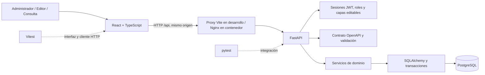
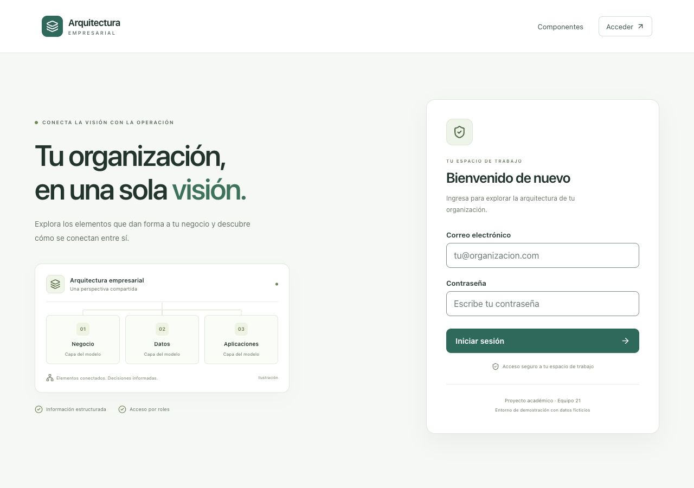
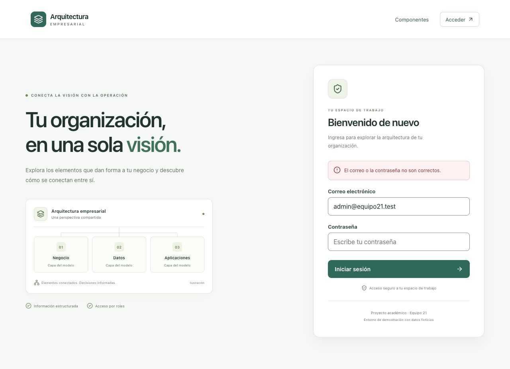
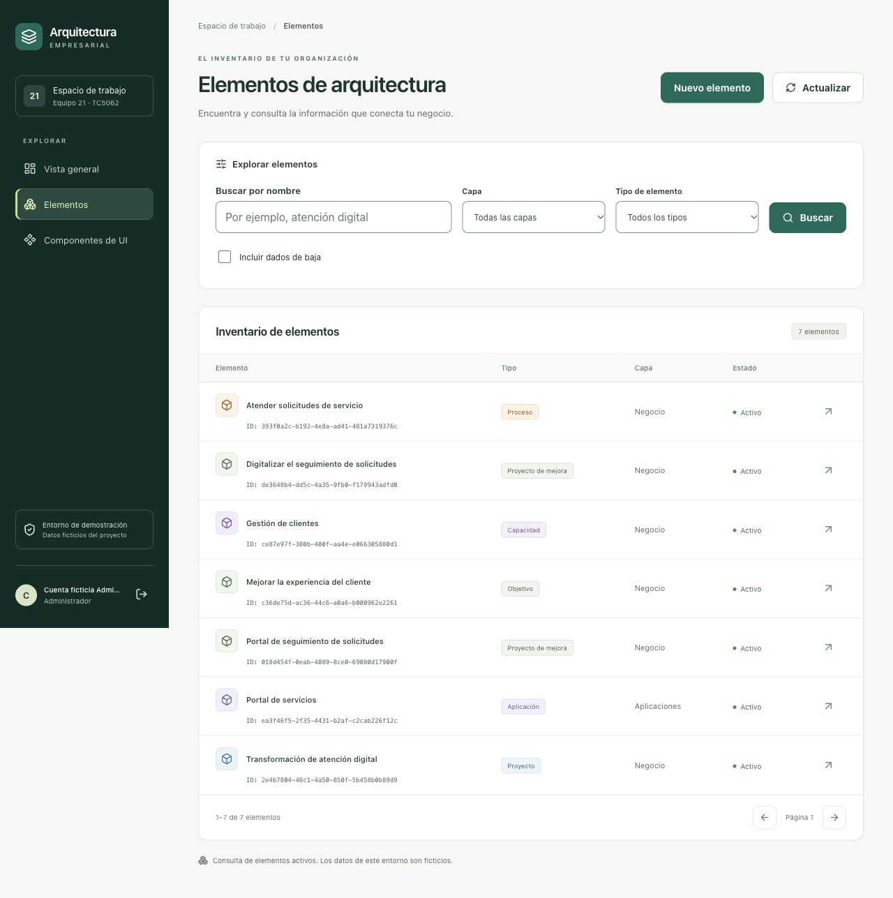
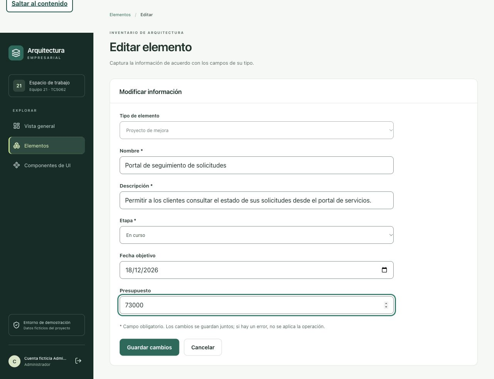
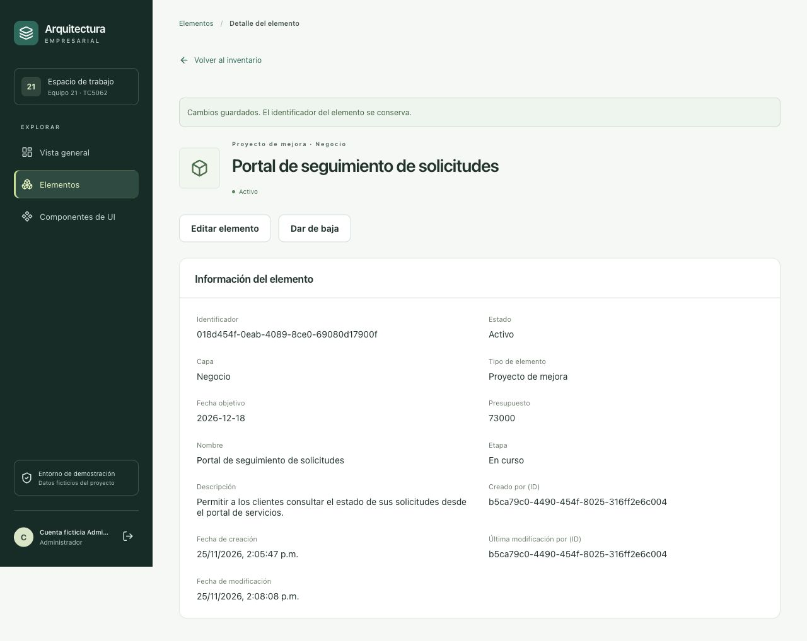
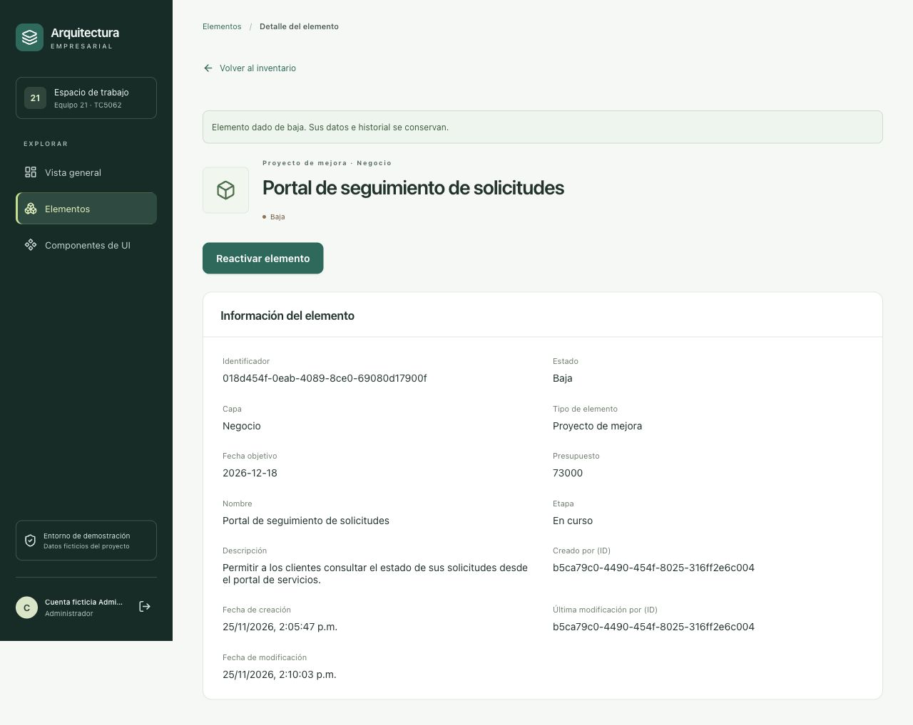

# Plataforma de Arquitectura Empresarial — Equipo 21

Proyecto colaborativo de **TC5062 · Análisis, diseño y construcción de software**. Documentación final S11-A1, revisada el **25 de noviembre de 2026**.

## Descripción y valor

La información sobre objetivos, proyectos, capacidades, procesos y aplicaciones suele estar dispersa entre archivos y áreas. Esto dificulta consultar un inventario común, mantenerlo actualizado y conocer quién cambió un registro.

La plataforma centraliza esa información en PostgreSQL y organiza el modelo como **capa → tipo de elemento → elementos**. La interfaz permite iniciar sesión, buscar registros y crear, editar, dar de baja y reactivar elementos según el rol y la capa asignada. La API también implementa propuestas y aprobación de relaciones, mapas de conexiones y bitácora.

**Estado del producto:** frontend y backend integrados; CRUD de elementos comprobado en el navegador. La configuración administrativa, las propuestas de relación, la consulta de bitácora y los mapas todavía carecen de pantallas completas. Los estados por requerimiento están en la [matriz de trazabilidad](S11_A1/matriz_trazabilidad.md). El [video de demo del equipo](S11_A1/demo_proyecto.mp4) está disponible; el alojamiento público sigue pendiente.

## Arquitectura



La interfaz utiliza un cliente Fetch común que adjunta el JWT, gestiona errores y vencimiento de sesión. Vite reenvía `/api` al backend durante el desarrollo, evitando solicitudes entre orígenes distintos. La alternativa con contenedores utiliza Nginx para el mismo propósito y para servir las rutas de React.

FastAPI registra las operaciones del [contrato canónico](S05_S06_A1/openapi_equipo.yaml), valida las entradas y comprueba sesión, rol y permisos por capa en el servidor. Los servicios aplican reglas de negocio y guardan cambios y bitácora en la misma transacción. La baja es lógica: conserva campos, relaciones e historial.

Se integró el frontend de `codex/s07-s08-frontend-integracion` y se trasladó a `backend/` la refactorización auditada de S09. `S09_A1/codigo/` se conserva como evidencia histórica; **el código ejecutable actual está en `backend/` y `frontend/`**. `postman/specs/openapi.yaml` enlaza al contrato canónico y no debe editarse como una segunda especificación.

## Stack tecnológico

Versiones comprobadas o fijadas en `frontend/package-lock.json` y `backend/requirements-quality.lock.txt`.

| Tecnología | Versión | Propósito |
|---|---|---|
| Python | 3.12.14 en la verificación S11 | Backend; usar Python 3.12 |
| FastAPI / Uvicorn | 0.162.0 / 0.54.0 | API REST y servidor ASGI |
| SQLAlchemy / psycopg | 2.1.6 / 3.3.6 | ORM, transacciones y conexión a PostgreSQL |
| PostgreSQL | 17.11 | Persistencia; requiere ICU y la colación `und-x-icu` |
| PyJWT / bcrypt | 2.15.1 / 5.0.0 | Sesiones y hash de contraseñas |
| PyYAML / jsonschema | 6.0.3 / 4.26.0 | Lectura y validación del contrato |
| python-dotenv | 1.2.4 | Configuración local |
| Node.js / npm | 24.21.0 / 12.2.3 en la verificación | Herramientas del frontend; usar Node 24 y npm compatible |
| React / React Router | 19.3.1 / 7.18.5 | Interfaz, navegación y rutas protegidas |
| TypeScript / Vite | 7.0.2 / 8.3.5 | Tipado, servidor de desarrollo y compilación |
| pytest / Vitest | 9.1.1 / 5.1.0 | Pruebas del backend y frontend |
| Docker Compose / Nginx | Compose v2 / imagen 1.28-alpine | Alternativa de ejecución; no ejecutada en la verificación S11 |

## Instalación y ejecución local

### 1. Requisitos y clonado

El recorrido nativo se comprobó en **macOS ARM64**, con Python 3.12, Node 24 y PostgreSQL 17 con ICU. Se necesitan `initdb`, `pg_ctl`, `createdb` y `psql`. PostgreSQL instalado mediante Homebrew suele encontrarse en `/opt/homebrew/opt/postgresql@17/bin`. Para otra plataforma, adapta `PG_BIN` o utiliza la alternativa Docker descrita abajo; no se verificó el instalador nativo en Windows.

```sh
git clone https://github.com/CLA-TC5062-SN2026/TC5062-21.git
cd TC5062-21
```

Las correcciones se integraron a `main` mediante el Pull Request #22; el clonado anterior obtiene la versión integrada.

### 2. Configurar las variables de entorno

```sh
python3 scripts/configurar_entorno.py
```

Este comando usa solo la biblioteca estándar: genera contraseñas y un secreto aleatorios para desarrollo en `backend/.env`, copia la configuración pública a `frontend/.env` y conserva archivos existentes. Si ya tienes un `.env`, verifica sus valores y compáralos con `backend/.env.example`. No copies literalmente los valores `CAMBIAR...` del ejemplo.

El instalador nativo usa un clúster privado en `.local/postgres`, puerto **55432**. Ese puerto debe estar libre. No modifica un servicio PostgreSQL global.

### 3. Instalar las dependencias

```sh
python3.12 -m venv .venv
.venv/bin/python -m pip install -r backend/requirements-quality.lock.txt
cd frontend
npm ci
cd ..
```

### 4. Preparar la base de datos

```sh
.venv/bin/python backend/scripts/setup_local.py
```

Si PostgreSQL está en otra ubicación:

```sh
PG_BIN=/ruta/a/postgresql17/bin .venv/bin/python backend/scripts/setup_local.py
```

El script inicializa el esquema, crea las cuatro capas base y cuentas ficticias Administrador, Editor y Consulta. Las credenciales se guardan únicamente en `.local/demo_credentials.json`; consulta ese archivo local para acceder y evita mostrarlo durante la grabación. `.env` y `.local/` están excluidos de Git.

### 5. Levantar backend y preparar la muestra

En la primera terminal, desde la raíz:

```sh
.venv/bin/python -m uvicorn backend.app.main:app --host 127.0.0.1 --port 8000
```

En otra terminal:

```sh
.venv/bin/python backend/scripts/prepare_frontend_demo.py
```

La carga es idempotente. Prepara objetivos, proyectos, capacidades, procesos y aplicaciones ficticios, una relación validada y un tipo **Proyecto de mejora** con Nombre, Descripción, Presupuesto, Fecha objetivo y Etapa. No borra ni sobrescribe modificaciones de los registros existentes.

### 6. Levantar frontend

En la segunda terminal:

```sh
cd frontend
npm run dev
```

Abre [la aplicación local](http://127.0.0.1:5173/login) y entra con la cuenta ficticia de Administrador para recorrer el CRUD. La cuenta Consulta permite leer, pero no modificar. Un Editor solo puede modificar las capas que un Administrador le asigne mediante la API.

| Dirección local | Uso |
|---|---|
| `http://127.0.0.1:5173/login` | Aplicación y autenticación |
| `http://127.0.0.1:8000/api/salud` | Disponibilidad de PostgreSQL |
| `http://127.0.0.1:8000/docs` | Swagger UI y operaciones administrativas |
| `http://127.0.0.1:8000/redoc` | Referencia de API |

Si aparece un error de conexión, verifica que la API esté en 8000 y `API_PROXY_TARGET` apunte a ese puerto. Mantén `VITE_API_URL=/api` en el desarrollo local para utilizar el proxy de Vite.

Para detener: `Ctrl+C` en las dos terminales y `/ruta/a/postgresql17/bin/pg_ctl -D .local/postgres stop` desde la raíz.

### Alternativa con Docker Compose

Se incluyen Dockerfiles y Nginx para frontend, API y PostgreSQL. Esta alternativa está preparada, pero **no se ejecutó Docker durante la verificación S11**.

```sh
python3 scripts/configurar_entorno.py
docker compose --env-file backend/.env up --build
```

La aplicación se sirve en `http://127.0.0.1:8080`; la API queda disponible en el puerto local 8000. En una base nueva provisiona el primer administrador con:

```sh
docker compose --env-file backend/.env exec api python backend/scripts/provision_admin.py --correo admin@equipo21.test --nombre Administrador
```

El programa pide la contraseña sin mostrarla. La importación inicial del SQL ocurre únicamente con un volumen vacío. No elimines volúmenes con datos para resolver un problema de arranque.

## Variables de entorno

| Variable | Necesaria | Formato o propósito, sin secretos reales |
|---|---|---|
| `DATABASE_URL` | Backend nativo | `postgresql+psycopg://<usuario>:<password>@<host>:<puerto>/<base>` |
| `JWT_SECRET` | Backend | Secreto aleatorio de al menos 32 bytes; sin valor predeterminado |
| `JWT_EXPIRATION` | Opcional | Segundos, entre 1 y 28800; por defecto 28800; inactividad máxima 30 minutos |
| `DB_PASSWORD` | Docker Compose | Contraseña de PostgreSQL; el configurador genera una URL segura |
| `VITE_API_URL` | Frontend, valor público | Prefijo `/api`; nunca debe contener secretos |
| `API_PROXY_TARGET` | Desarrollo Vite | Origen del backend; por defecto `http://127.0.0.1:8000` |
| `PG_BIN` | Instalador nativo, si cambia la ubicación | Carpeta de binarios PostgreSQL 17 |

## Ejecución de pruebas

Desde la raíz, con PostgreSQL local iniciado y `backend/.env` configurado:

```sh
.venv/bin/python -m pytest backend/tests -q
cd frontend
npm test
npm run lint
npm run build
```

La suite backend crea y reconstruye únicamente **`arquitectura21_test`** en la conexión de desarrollo configurada; requiere permiso para crear esa base. No uses una conexión de producción. Ejecuta esta suite y la medición de S09 secuencialmente, porque comparten la base de pruebas.

Resultado comprobado en S11: **88 pruebas backend aprobadas**, con una advertencia de deprecación Starlette/httpx; **19 pruebas frontend aprobadas**; compilación correcta; lint frontend sin errores y con cinco advertencias existentes. El recorrido de integración cubre las **46 operaciones** del contrato. Esto no equivale a demostrar todos los criterios funcionales, rendimiento o compatibilidad entre navegadores.

También se ejecutó la colección local de autenticación de Postman: **6 solicitudes, 22 aserciones, 0 fallos**. Los reportes están en [S11_A1/evidencias/](S11_A1/evidencias/) y los pasos y límites de la comprobación visual en [verificación de demo](S11_A1/verificacion_demo.md). La auditoría original permanece en [S09_A1/code_review.md](S09_A1/code_review.md).

## URL de producción

**Pendiente: el equipo confirmó que todavía no dispone de hosting.** Las direcciones `127.0.0.1` son exclusivamente locales. La demo de esta actividad utiliza el stack local, como permiten las especificaciones de entrega.

Antes de publicar, se debe provisionar PostgreSQL, configurar secretos propios del alojamiento, servir el frontend y `/api` bajo un origen HTTPS y comprobar autenticación y persistencia. Después se debe reemplazar este estado por la URL pública verificada. La configuración Compose incluida no acredita un despliegue público.

## Capturas de las vistas principales

Capturas auténticas del recorrido local S11 con datos ficticios; los identificadores corresponden a esa instalación y cambian en una nueva.

### Acceso y manejo de errores





### Inventario y captura





### Detalle y baja lógica





## Entrega S11-A1

- [Matriz de trazabilidad](S11_A1/matriz_trazabilidad.md).
- [Retrospectiva y consistencia problema–solución](S11_A1/retrospectiva_proyecto.md).
- [Guion y preparación del video de máximo cinco minutos](S11_A1/guion_demo.md).
- [Verificación y pendientes de la demo](S11_A1/verificacion_demo.md).
- [Video de demo del equipo](S11_A1/demo_proyecto.mp4).

Genera un ZIP de preparación con `python3 scripts/empaquetar_s11.py`. Después de grabar en equipo, coloca `demo_proyecto.mp4` en `S11_A1/`. Si supera 100 MB, comparte el video y agrega su URL real en `S11_A1/demo_link.txt`. Ejecuta `python3 scripts/empaquetar_s11.py --final` para generar el ZIP final de Canvas. El verificador exige imagen, audio y duración máxima de 300 segundos cuando se entrega un MP4 local; la narración, continuidad y participación del equipo deben revisarse manualmente.

El video se incorporó el **27 de noviembre de 2026**, con su contenido original: dura **5:00.315** y pesa **22,170,821 bytes**. El equipo indicó conservarlo completo. El modo estricto `--final` exige un máximo de 300 segundos y rechaza esta duración; el ZIP con el archivo original se preparó por separado.

La entrega final debe subirse a Canvas y al repositorio del equipo **24 horas antes de la presentación**. Este repositorio no acredita una entrega a Canvas.
