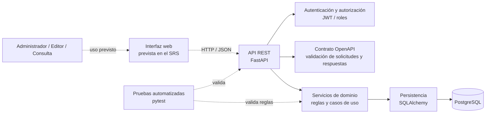

# TC5062-21
# Plataforma de Arquitectura Empresarial — Equipo 21

Repositorio del proyecto desarrollado para TC5062. Esta documentación se actualizó contrastando el SRS, el Product Backlog, el backend y la evidencia de la auditoría de calidad de Semana 9.

## 1. Descripción del proyecto

Las organizaciones necesitan consultar de forma integrada qué objetivos, proyectos, capacidades, procesos y aplicaciones tienen, así como entender cómo se relacionan. Actualmente, esa información puede encontrarse distribuida entre archivos, documentos y distintas áreas, lo que dificulta mantener una visión común, localizar dependencias y dar seguimiento a los cambios.

La **Plataforma de Arquitectura Empresarial** propone centralizar esa información en un modelo estructurado y consultable. Organiza los registros mediante capas (Negocio, Datos, Aplicaciones y Tecnología), tipos de elemento, elementos concretos y relaciones explícitas entre ellos. También contempla propuestas de relaciones sujetas a revisión, búsqueda, mapas de conexiones y bitácora de auditoría.

El valor que entrega es disponer de una fuente común de información de arquitectura, mejorar la trazabilidad de los cambios y facilitar la exploración de dependencias entre componentes de la organización.

### Alcance funcional definido en el SRS

- Autenticación y administración de sesiones.
- Administración de usuarios, roles y capas editables.
- Configuración de capas, tipos de elemento, campos y tipos de relación.
- Registro, modificación, búsqueda, consulta, baja lógica y reactivación de elementos.
- Propuestas de alta, cambio y retiro de relaciones, con aprobación o rechazo.
- Exploración de mapas de relaciones, cruces y filtros.
- Datos ficticios para demostración, persistencia y bitácora.

### Estado real de la entrega disponible

El repositorio contiene una implementación backend en FastAPI y PostgreSQL, con contrato OpenAPI y pruebas automatizadas. La evidencia de Semana 9 registra **84 pruebas aprobadas** y un recorrido de las **46 operaciones** del contrato. La implementación no debe confundirse con una aplicación web terminada: en el árbol revisado no se encontró un frontend web ni un despliegue productivo verificable. Por ello, la API y sus pruebas son evidencia del comportamiento backend, pero no sustituyen una interfaz visual para los usuarios.

## 2. Arquitectura

### Diagrama de componentes



**Lectura del diagrama:** el SRS contempla una interfaz web para los perfiles Administrador, Editor y Consulta. La implementación disponible en el repositorio se concentra en el backend: FastAPI expone las rutas REST, valida las solicitudes contra el contrato OpenAPI y delega la lógica de negocio a servicios. SQLAlchemy gestiona la persistencia en PostgreSQL. La autenticación usa tokens JWT y la autorización considera roles y permisos por capa. Pytest verifica operaciones, reglas e integración.

> La interfaz web aparece como parte del producto especificado, pero no se encontró código frontend en la versión del repositorio revisada. El diagrama distingue por ello la interfaz prevista de los componentes backend implementados.

### Responsabilidades principales

| Componente | Responsabilidad | Estado |
|---|---|---|
| Interfaz web | Formularios, navegación, búsqueda y mapas para los tres perfiles | Prevista en SRS; no localizada en el repositorio revisado |
| FastAPI | Exponer endpoints REST y documentación interactiva | Implementado |
| Contrato OpenAPI | Definir operaciones, esquemas y validaciones | Implementado; contrato integrado en backend |
| Servicios de dominio | Reglas de negocio para cuentas, capas, elementos, relaciones y auditoría | Implementado |
| SQLAlchemy | Consultas y transacciones de persistencia | Implementado |
| PostgreSQL | Almacenar usuarios, capas, tipos, elementos, relaciones, sesiones y bitácora | Esquema e integración de pruebas incluidos |
| Pytest | Pruebas de integración, reglas y contrato | 84 pruebas aprobadas en evidencia de Semana 9 |

## 3. Stack tecnológico

Versiones tomadas del archivo `backend/requirements-quality.lock.txt` y de la evidencia de ejecución de Semana 9. Las versiones de Python y PostgreSQL corresponden al entorno registrado para esa ejecución.

| Tecnología | Versión registrada | Propósito |
|---|---:|---|
| Python | 3.12.16 | Lenguaje del backend |
| FastAPI | 0.162.0 | API REST |
| Uvicorn | 0.54.0 | Servidor ASGI |
| SQLAlchemy | 2.1.6 | ORM y transacciones |
| PostgreSQL | 17.11 | Base de datos relacional |
| psycopg / psycopg-binary | 3.3.6 | Driver PostgreSQL |
| Pydantic | 2.14.3 | Modelos y validación de datos |
| PyJWT | 2.15.1 | Emisión y validación de tokens |
| bcrypt | 5.0.0 | Hash de contraseñas |
| python-dotenv | 1.2.4 | Lectura de variables de entorno |
| PyYAML | 6.0.3 | Lectura del contrato OpenAPI |
| jsonschema | 4.26.0 | Validación de esquemas |
| pytest | 9.1.1 | Pruebas automatizadas |
| Pylint | 4.1.3 | Análisis estático |

## 4. Estructura relevante del repositorio

```text
TC5062-21/
├── S03_A1/
│   ├── SRS_equipo.md
│   └── backlog.md
├── S09_A1/
│   ├── README.md
│   ├── REPRODUCCION.md
│   ├── evidencias/
│   │   └── despues/
│   │       ├── pytest.txt
│   │       ├── pruebas_ejecucion.json
│   │       └── cobertura_operaciones.json
│   └── codigo/
│       ├── S05_S06_A1/
│       │   ├── openapi_equipo.yaml
│       │   └── esquema_bd.sql
│       └── backend/
│           ├── app/
│           ├── scripts/
│           ├── tests/
│           ├── requirements.txt
│           └── requirements-quality.lock.txt
└── S11_A1/
    ├── matriz_trazabilidad.md
    └── retrospectiva_proyecto.md
```

## 5. Instalación y ejecución local

Los comandos siguientes corresponden a la estructura que contiene el backend auditado. Requisitos: Git, Python 3.12, PostgreSQL 17 y sus herramientas (`initdb`, `pg_ctl`, `createdb`, `psql`).

### Paso 1. Clonar el repositorio

```bash
git clone https://github.com/CLA-TC5062-SN2026/TC5062-21.git
cd TC5062-21
cd S09_A1/codigo
```

### Paso 2. Crear y activar un entorno virtual

```bash
python3.12 -m venv .venv
```

macOS / Linux:

```bash
source .venv/bin/activate
```

Windows PowerShell:

```powershell
.venv\Scripts\Activate.ps1
```

### Paso 3. Instalar dependencias bloqueadas

```bash
python -m pip install --upgrade pip
python -m pip install -r backend/requirements-quality.lock.txt
```

El archivo lock fija las versiones utilizadas en la reproducción de la auditoría. `backend/requirements.txt` contiene las dependencias principales de la aplicación.

### Paso 4. Preparar PostgreSQL y las variables de entorno

El script `backend/scripts/setup_local.py` prepara una instancia local aislada, crea la base `arquitectura21`, carga `S05_S06_A1/esquema_bd.sql`, genera `backend/.env` si no existe y provisiona cuentas ficticias para pruebas y demostración.

En macOS con PostgreSQL 17 instalado mediante Homebrew, el script usa por defecto `/opt/homebrew/opt/postgresql@17/bin`. Si tus binarios están en otra ubicación, define `PG_BIN`:

```bash
PG_BIN=/ruta/a/postgresql17/bin python backend/scripts/setup_local.py
```

En PowerShell:

```powershell
$env:PG_BIN = "C:\ruta\a\postgresql\bin"
python backend/scripts/setup_local.py
```

El script crea `backend/.env` con estas variables:

| Variable | Obligatoria | Descripción |
|---|---|---|
| `DATABASE_URL` | Sí | Conexión SQLAlchemy a PostgreSQL usando `postgresql+psycopg://` |
| `JWT_SECRET` | Sí | Secreto aleatorio de al menos 32 bytes para firmar tokens |
| `JWT_EXPIRATION` | No | Duración del token en segundos; valor predeterminado 28800 y máximo 28800 |

No publiques `backend/.env`, `.local/` ni `demo_credentials.json`. El script limita los permisos de los archivos sensibles en sistemas compatibles. Para otro entorno, crea esas variables con credenciales propias de desarrollo; nunca uses secretos reales en documentación o control de versiones.

### Paso 5. Levantar el backend

Desde `S09_A1/codigo/`, con el entorno virtual activo y PostgreSQL iniciado:

```bash
uvicorn backend.app.main:app --reload --host 127.0.0.1 --port 8000
```

URLs locales:

- API: `http://127.0.0.1:8000`
- Salud: `http://127.0.0.1:8000/api/salud`
- Swagger UI: `http://127.0.0.1:8000/docs`
- ReDoc: `http://127.0.0.1:8000/redoc`

No hay instrucciones de arranque para frontend porque no se encontró un proyecto frontend en el repositorio revisado.

## 6. Ejecución de pruebas

La suite está ubicada en `S09_A1/codigo/backend/tests/`. La evidencia almacenada en `S09_A1/evidencias/despues/pytest.txt` registra **84 passed, 1 warning** en 7.65 segundos. El test de integración `test_all_46_operations_and_persistence` recorre las 46 operaciones del contrato y valida los esquemas de respuesta y la persistencia. También existen pruebas de integración de calidad y reglas de valores.

Ejecuta desde `S09_A1/codigo/`:

```bash
python -m pytest backend/tests -q
```

Para generar un reporte JUnit:

```bash
python -m pytest backend/tests -q --junitxml=pytest-report.xml
```

La reproducción documentada recomienda ejecutar la suite y la medición de consultas secuencialmente, porque ambas usan la misma base aislada. Consulta `S09_A1/REPRODUCCION.md` para repetir exactamente la auditoría, configurar PostgreSQL y ejecutar `backend/scripts/medir_consultas_s09.py` y `backend/scripts/auditar_calidad.py`.

**Resultado registrado:** 84 pruebas aprobadas. La evidencia incluye una advertencia de deprecación relacionada con `httpx` y `starlette.testclient`; no equivale a una ejecución sin advertencias.

## 7. Variables de entorno

| Variable | Ejemplo de formato (sin secreto real) | Uso |
|---|---|---|
| `DATABASE_URL` | `postgresql+psycopg://<usuario>:<password>@<host>:<puerto>/<base>` | Conexión a PostgreSQL |
| `JWT_SECRET` | `<secreto_aleatorio_de_32_bytes_o_mas>` | Firma de tokens JWT |
| `JWT_EXPIRATION` | `28800` | Expiración del token en segundos |

El script de preparación local genera valores de desarrollo. La aplicación valida que `DATABASE_URL` use el driver `postgresql+psycopg`, que `JWT_SECRET` tenga al menos 32 bytes y que `JWT_EXPIRATION` esté entre 1 y 28800 segundos.

## 8. URL de producción

**No se encontró una URL de producción publicada o verificable** en el repositorio revisado. La dirección `http://127.0.0.1:8000` corresponde únicamente a ejecución local y no debe presentarse como despliegue público.

## 9. Capturas de pantalla

No se localizaron capturas de la interfaz web en el repositorio revisado. Para completar esta sección con evidencia auténtica, se recomienda capturar:

1. Swagger UI (`/docs`) con el contrato de la API.
2. Respuesta del endpoint de salud.
3. Flujo de autenticación y consulta del perfil.
4. Creación y consulta de una capa.
5. Registro y búsqueda de elementos.
6. Propuesta y aprobación/rechazo de una relación.
7. Consulta de mapa y bitácora, cuando se demuestren desde una interfaz o cliente API.

Inserta únicamente capturas reales de una ejecución del proyecto. Ejemplo de inclusión cuando existan:

```markdown

```

## 10. Limitaciones conocidas

- La versión del repositorio revisada contiene backend y pruebas, pero no un frontend web verificable.
- No se identificó un despliegue productivo ni una URL pública.
- Las pruebas registradas validan las operaciones del backend; no acreditan usabilidad ni comportamiento de una interfaz no incluida.
- El resultado de Pylint de Semana 9 conserva observaciones de convención, advertencia y refactorización, documentadas en la auditoría.
- El sistema debe demostrarse con datos ficticios, de acuerdo con el SRS.
