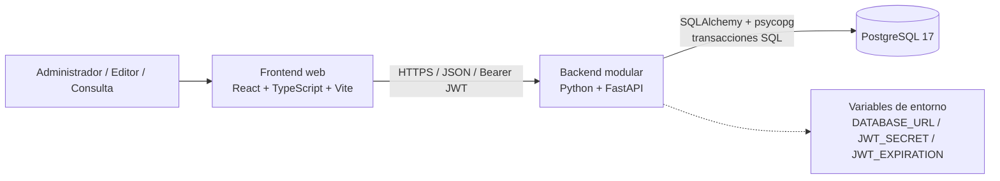
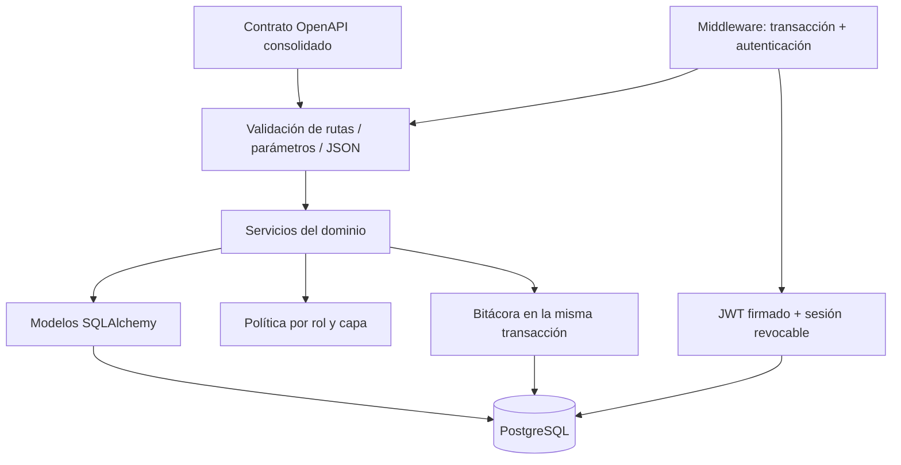

# Arquitectura consolidada — Equipo 21

Fecha: 25 de octubre de 2026. Resolución técnica para esta implementación, preparada a partir de los diseños de Gregorio, Jean Paul y Liciel. Los integrantes deben revisar la consolidación antes de su entrega; este documento no acredita una aprobación previa del equipo o del cliente.

## Contenedores

El frontend se conserva como decisión de arquitectura; estas actividades implementan el backend. En desarrollo, Uvicorn escucha únicamente en `127.0.0.1:8000`. En despliegue se requiere HTTPS mediante el punto de entrada de la infraestructura. El proveedor cloud permanece pendiente, como en los tres diseños; no se inventa un despliegue público.

## Componentes internos del backend

El contrato es la fuente de rutas, métodos, validaciones y respuestas documentadas. `services.py` implementa los casos de uso y usa SQLAlchemy para persistencia. No se añaden interfaces Repository vacías: se conserva la separación propuesta por Liciel mediante módulos concretos, sin introducir una capa que solo replique llamadas del ORM. Los esquemas SQL y el diagrama de clases se generan desde los mismos modelos y se revisan contra OpenAPI.

## Decisiones de ejecución

- Dominio bajo `/api/v1`, con recursos en español y campos camelCase. Autenticación académica bajo `/api/auth` para cumplir S05-S06-A2.
- PostgreSQL almacena los cuatro tipos de campo con columnas tipadas, restricciones y claves foráneas; JSONB se reserva para instantáneas de bitácora y el resultado de carga de demostración.
- Las escrituras y su bitácora usan una transacción. Un bloqueo asesor transaccional serializa escrituras en esta versión académica y evita carreras de último administrador, propuestas y validación de estructuras. Su capacidad debe medirse antes de ampliar la carga; no se afirma cumplimiento del RNF de rendimiento sin medición.
- Las llamadas SQL bloqueantes se ejecutan en el pool de hilos para permitir peticiones concurrentes sin detener el bucle ASGI.
- Los permisos se consultan en servidor por solicitud. El JWT no decide roles. La cuenta y la sesión deben seguir activas; hay revocación individual y por cuenta.
- bcrypt con coste 12. La contraseña no se devuelve, ni siquiera en altas administrativas. El registro público crea exclusivamente Consulta y rechaza un rol enviado por el cliente.
- El backend final queda protegido. La evidencia A1 se obtiene de una instantánea temporal local de la etapa CRUD sin autenticación; esa etapa se detiene después de grabar su video y no forma parte del arranque final.

## Coherencia y reproducción

`backend/scripts/build_contract.py` conserva las extensiones de los 56 criterios canónicos; `export_sql.py` genera `esquema_bd.sql`; `build_design_docs.py` genera `diagrama_clases_equipo.puml`. La correspondencia entre API, modelo y tablas, junto con las correcciones verificadas, se documenta en `revision_sql.md`.
