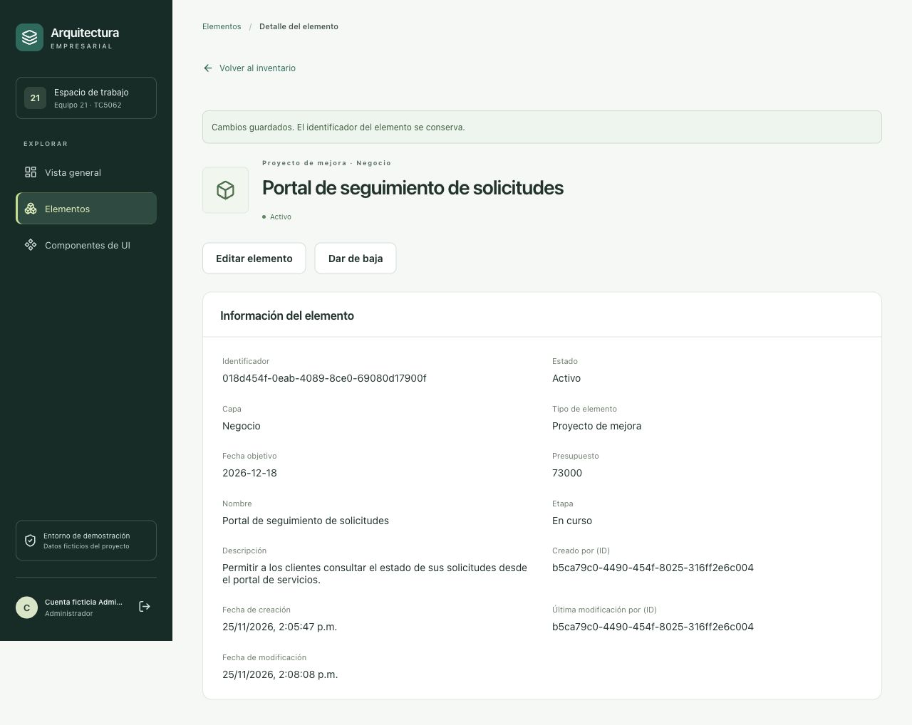

# Retrospectiva del proyecto y consistencia problema–solución

**Plataforma de Arquitectura Empresarial · Equipo 21 · S11-A1 · 25 de noviembre de 2026**

Fuentes: [SRS del equipo](../S03_A1/SRS_equipo.md), [backlog completo](../S03_A1/backlog_completo.md), [reflexión de S03](../S03_A1/reflexion.md), [auditoría de S09](../S09_A1/code_review.md), código integrado y [verificación S11](verificacion_demo.md).

## Sección A — Retrospectiva SCRUM

### ¿Qué salió bien?

- **Se consolidó una línea base compartida.** Los borradores individuales se integraron en un SRS de 19 RF y 56 criterios con IDs estables. El backlog reúne 21 historias en cinco épicas y permite relacionar el comportamiento esperado con el contrato.
- **La API y la base de datos cubren el modelo central.** Las 46 operaciones incluyen sesiones, cuentas, configuración, elementos, propuestas, decisiones, relaciones, mapas y bitácora. La baja lógica y la aprobación separada de relaciones conservan información e historial.
- **La refactorización contó con mediciones.** S09 redujo los SELECT de una página de 25 elementos entre 300 registros de 602 a 53; guardar ocho campos pasó de 10 a 2 y modificar un nombre de nueve campos de 57 a 30. Estos son conteos de consultas, no resultados de latencia o concurrencia.
- **Se conservaron evidencias reproducibles.** S09 documenta 84 pruebas aprobadas. El cierre S11 integra esa refactorización en el backend principal y verifica 88 casos backend, 19 frontend y 22 aserciones Postman, con sus límites y advertencias registrados.
- **El recorrido principal ya puede demostrarse desde la interfaz.** Login, búsqueda, alta, edición, baja, consulta histórica y reactivación se comprobaron con una API y una base reales de desarrollo, usando información ficticia completa.

### ¿Qué no salió bien?

- **Las ramas no se integraron al ritmo de la documentación.** El frontend de S07–S08 estaba en `codex/s07-s08-frontend-integracion`, mientras `main` contenía la auditoría de S09 y los documentos de S11. El primer README final concluyó que no había frontend al revisar únicamente `main`. Hubo que integrar ambos trabajos y conservar la refactorización de S09 para evitar una regresión.
- **La matriz inicial contenía rutas que no existían.** Entre otras diferencias, usaba `PUT /elementos/{id}/estado` para la baja y `GET/POST` para cargar la muestra, cuando el contrato implementa DELETE/PATCH sobre el elemento y PUT sobre la demostración. El cierre corrigió los vínculos contra el contrato y el código.
- **Contar operaciones ejecutadas no bastó para comprobar los criterios.** La suite recorría 46 operaciones, pero no tenía escenarios explícitos de protección del último administrador ni del ciclo completo de rechazo/cambio/retiro de relaciones. Se añadieron esos casos; otras brechas de pruebas siguen identificadas en la matriz.
- **Una prueba visual detectó un problema que las pruebas aisladas no mostraron.** Al capturar una fecha y continuar con otro campo, la fecha podía no llegar al estado del formulario en el navegador usado para la demo. Se corrigió el manejo de entrada y se volvió a comprobar el valor persistido. Esto mostró la necesidad de probar la integración real.
- **El alcance visual sigue incompleto.** Hay interfaz para el inventario, pero no para administrar cuentas y definiciones, revisar propuestas ni explorar el mapa. El backend no sustituye esas experiencias de usuario.
- **La deuda de calidad no desapareció por tener pruebas verdes.** S09 registró Pylint 5.13/10, con 492 mensajes C/W/R y sin errores/fatales. Esa es evidencia histórica; no se presenta como una medición nueva. En S11, el lint frontend conserva cinco advertencias y pytest una de deprecación.

### ¿Qué haríamos diferente la próxima vez?

1. Acordar con el stakeholder un recorrido mínimo verificable: registrar un proyecto, actualizarlo y recuperar su información con una sesión nueva.
2. Completar incrementos de extremo a extremo —persistencia, API, pantalla y prueba— antes de ampliar el catálogo de endpoints.
3. Revisar al cerrar cada sprint las ramas pendientes y el estado de integración en la rama que utilizará quien evalúe el producto.
4. Mantener la matriz por criterio desde el desarrollo y diferenciar pruebas de éxito, rechazo, permisos, persistencia y comportamiento visual.
5. Usar una Definition of Done que exija instrucciones reproducibles, datos de demostración y evidencia de navegador, además de pruebas automatizadas.
6. Reservar tiempo para alojamiento, validación con usuarios y ensayo del video. El entorno local funciona, pero una URL pública no se obtiene solo redactando su sección en el README.

### Uso de herramientas y agentes de IA

**Fases de mayor utilidad.** En requisitos y backlog, los agentes ayudaron a estructurar épicas, historias y criterios; la reflexión de S03 documenta el refinamiento de sus propuestas. En diseño apoyaron el contrato, diagramas y documentación. En S09 facilitaron revisar consultas, separar reglas de valores y preparar regresiones. En S11 fueron útiles para cruzar documentos con el código, recuperar el frontend de otra rama, completar el CRUD y preparar reportes y capturas.

**Trabajo adicional que generaron.** Las propuestas iniciales del backlog necesitaron corregir estimaciones uniformes, historias con varias acciones y criterios omitidos. En la documentación final fue necesario corregir inferencias basadas en una sola rama y endpoints plausibles que no coincidían con el contrato. El formulario añadido con asistencia del agente necesitó una corrección tras probar la fecha en el navegador. Estos ejemplos muestran que un texto o un código generado y bien presentado todavía necesita verificación.

**Cómo cambió la forma de programar.** El trabajo pasó a apoyarse más en especificaciones, revisión de diferencias y pruebas antes de aceptar una salida del agente. La contribución útil no fue solo generar archivos: también consistió en contrastar resultados con la fuente y repetir un recorrido observable. Las decisiones de alcance y la aceptación del producto corresponden al equipo; la IA no reemplaza la validación con el stakeholder.

## Sección B — Consistencia problema–solución

### ¿La aplicación resuelve el problema planteado desde Semana 2?

**Lo atiende de forma parcial y concreta.** El problema, consolidado en el SRS §1.2, es la dispersión de objetivos, proyectos, capacidades, procesos y aplicaciones entre archivos y áreas. La aplicación ya permite consultar un inventario común y mantener sus elementos con control de acceso y persistencia. Eso reduce la necesidad de volver a capturar la misma información y conserva responsables y fechas.

La parte de comprender visualmente las dependencias sigue incompleta: la API devuelve relaciones y datos de mapas, pero todavía no existe una vista gráfica interactiva. Tampoco se realizó una validación de usabilidad con las áreas del stakeholder. Por ello, no afirmamos haber resuelto todo el problema de arquitectura empresarial.

| Necesidad | Respuesta implementada | Evidencia concreta |
|---|---|---|
| Consultar un inventario común | Listado, búsqueda, filtros y detalle sobre PostgreSQL | [Inventario](capturas/04_inventario.png), `ElementsPage.tsx`, prueba I de la matriz |
| Mantener datos útiles | Alta y edición de Nombre, Descripción, Presupuesto, Fecha objetivo y Etapa | [Formulario real](capturas/06_formulario.png), casos M-02 y M-03 |
| Evitar información incompleta | Campos obligatorios y validación atómica | [Error manejado](capturas/05_validacion.png), pruebas de `value_rules` y de rollback |
| Conservar historia y responsables | Baja lógica, autoría y fechas | [Detalle](capturas/07_detalle.png), [baja](capturas/08_baja.png), casos M-05 y M-06 |
| Continuar el trabajo entre sesiones | Recuperación del registro guardado tras cerrar sesión y volver a acceder | Caso M-07; persistencia e integración backend |
| Controlar las relaciones publicadas | Propuestas y aprobación/rechazo en servidor | `test_relation_rejection_change_and_retirement_require_decision`; falta la interfaz de este flujo |

Las capturas proceden de la ejecución local S11. Los nombres y presupuestos son ficticios y están completos; no se presentan como datos de una empresa real.

### ¿Qué partes no se resolvieron y por qué?

- **Pantallas administrativas, propuestas y mapas:** estaban dentro del alcance del producto, pero no se completó su interfaz. Son brechas de implementación e integración, no exclusiones originales del SRS.
- **Truncado del mapa:** la implementación ordena vecinos por nombre/ID; el criterio RF-13-AC-3 exige orden por ID. Sigue pendiente alinear ese detalle y comprobar un conjunto de más de 100 nodos.
- **Alojamiento público:** aún no hay un despliegue público. La demo se realizó sobre el stack local. La URL de producción sigue pendiente.
- **Validación con usuarios, accesibilidad y rendimiento completos:** el ensayo técnico y las mediciones de consultas no prueban utilidad percibida, conformidad de accesibilidad ni el escenario de diez sesiones y tiempos máximos del RNF. Tampoco se verificaron las dos últimas versiones de Chrome y Edge.
- **Importación, sincronización empresarial, SSO, permisos por elemento y análisis automático:** se excluyeron explícitamente de la primera versión en el SRS. No se atribuyen a un obstáculo técnico que el equipo no haya documentado.

### ¿Qué demostraríamos primero al stakeholder y por qué?

Empezaríamos por una necesidad reconocible: **localizar y actualizar la iniciativa “Digitalizar el seguimiento de solicitudes” dentro de un inventario común**. Mostraríamos su descripción, presupuesto, etapa y fecha; guardaríamos un cambio y recuperaríamos el mismo identificador. Después mostraríamos una validación y una baja lógica con sus datos conservados.

Este orden permite ver el valor antes de explicar herramientas: la información se encuentra, se modifica con control y no se pierde por retirarla del inventario activo. A continuación explicaríamos que la API ya conserva relaciones aprobadas, pero que su exploración gráfica y revisión desde la interfaz siguen pendientes. Esa distinción permite que el stakeholder evalúe lo que realmente puede utilizar hoy y priorice el siguiente incremento.
